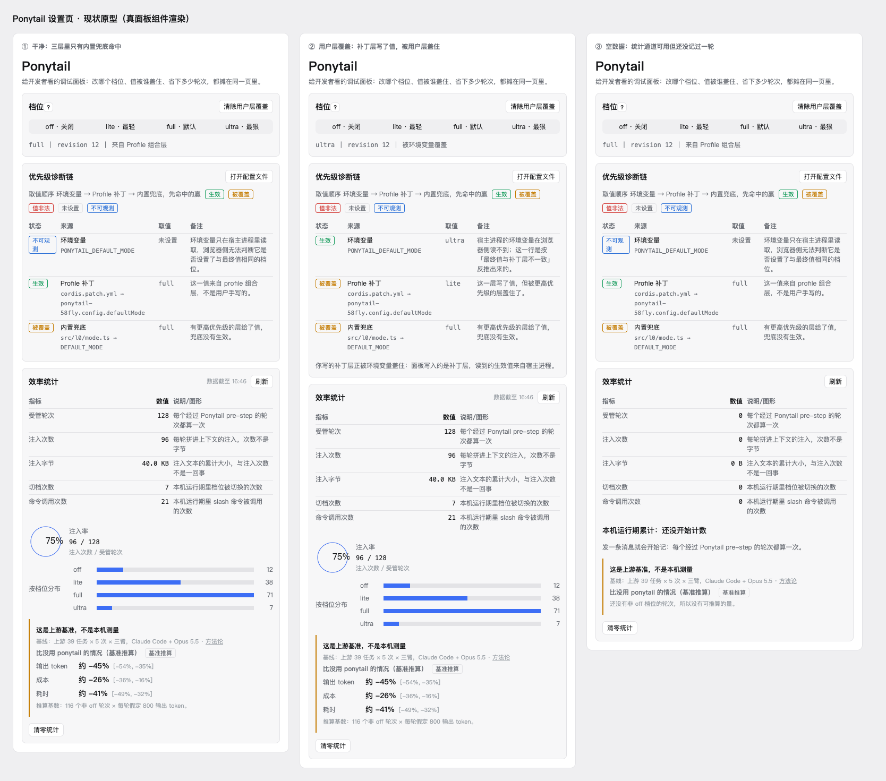
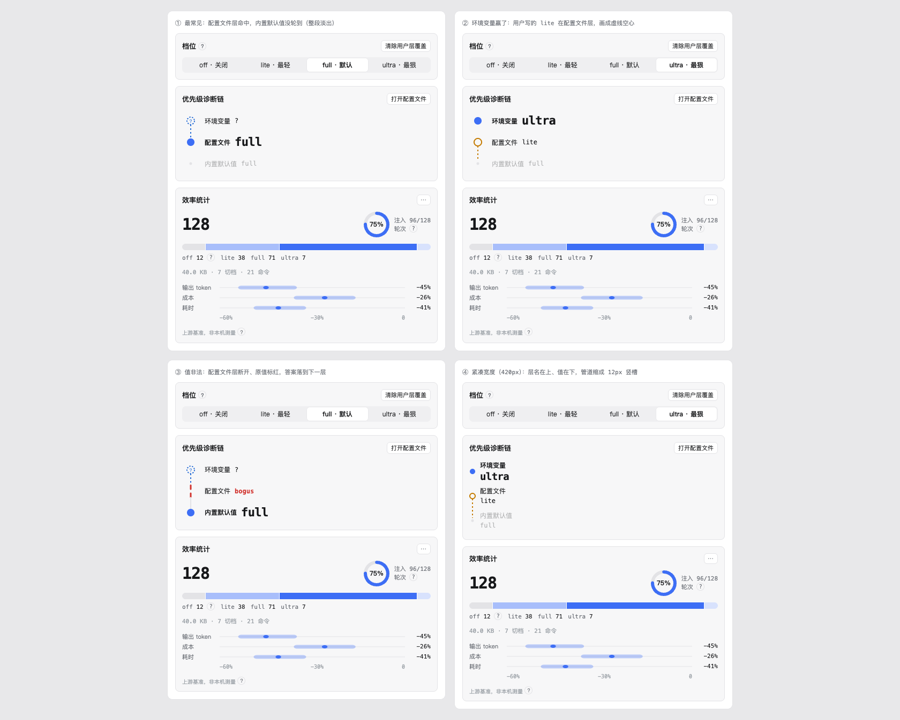

# Ponytail 面板 · 图形化改造方案

> **已实现（0.4.0）。** 落点：`.scratch/ponytail-visual/spec.md` 与票 01–03；现行规范见
> `docs/design/ponytail-settings-ui.md` §4、§5、§8.1。本文保留为讨论过程的记录，**不再作为实现依据**——
> 与上面两份规范冲突时以规范为准。四格现状截图见 `prototype-shots/final-*.png`。

面板现在的毛病不是「字写得不清楚」，是**用文字承担了本该由位置和形状承担的信息**：三层的优先级关系、谁命中、谁被跳过，全部靠一列状态标签加一列备注讲。读者要在脑子里把这些字重组成一张图——那不如直接把图给他。

两轮证据：

- 现状（真 `PonytailPanel` 组件渲染）：
- 方案（静态原型）：

| 卡片 | 现状汉字数 | 方案汉字数 | 变化 |
| --- | --- | --- | --- |
| 优先级诊断链 | 179 | 22 | −88% |
| 效率统计 | 195 | 31 | −84% |

（只数可见汉字，含按钮词；SVG 文本与数字不计。脚本口径见 `.scratch/ponytail-visual/`。）

## 一、诊断链：从「四列表格」改成一截管道

### 病根一：状态词讲的是「结果」，读者要的是「过程」

表格四列是 `状态｜来源｜取值｜备注`，但取值顺序是三步扫描。读者得自己在行间补出「先看 env，它有值就停；没有才看补丁；再没有才用兜底」这条规则——所以卡头才要写一句 `取值顺序 环境变量 → Profile 补丁 → 内置兜底，先命中的赢`，还要配五个状态标签的图例。**规则句加图例，就是表格讲不清自己的证据。**

### 病根二：「被覆盖」这个词在多数场景下是错的

`diagnose()` 的判据是「谁的值等于最终生效值，谁命中」（`src/l0/diagnosis.ts:145`）。兜底层永远有值，所以在最常见的干净场景里，面板显示：

```
生效   Profile 补丁   full
被覆盖  内置兜底      full   有更高优先级的层给了值，兜底没有生效。
```

兜底从来没被「覆盖」，它只是**没轮到**。真正被覆盖只有一种情况：`overriddenBy !== null`，即用户写了值但 env 赢了。现状把这两种截然不同的事共用同一个标签，用户读完自然困惑。

### 病根三：`patchRaw` 与 `patchMode` 取自不同层，非法值会显示成「生效」

`src/l0/diagnosis.ts:157-160`：

```ts
const patchMode = user.mode ?? base.mode;
const patchRaw = user.raw ?? base.raw;
```

当 `user.defaultMode = 'bogus'`、`base.defaultMode = 'full'` 时，`patchRaw = 'bogus'`、`patchMode = 'full'`，于是走 `patchMode === effective` 分支，得到 **`patch: hit, value: 'bogus'`**——面板报告一个不认识的档位「生效了」，而实际生效值是 `full`。实测：

```
H 非法+base | eff full | patch:hit=bogus  fallback:shadowed=full
```

这是渲染层改不掉的判据缺陷。方案不修它（见 §五），但渲染层按「值不在四档里就不算命中」自行降级为断开——图会把它讲成「这里不通」，而不是「这里生效」。

### 方案：一截管道，三层节点，命中处就是答案

```
        ●  环境变量     ultra        ← 实心 = 命中，值 22px 等宽
        ┊
        ○  配置文件     lite         ← 虚线空心 = 写了没赢
        ┊
        ·  内置默认值   full         ← 淡出 = 压根没轮到
```

- 竖线是取值顺序，从上往下扫；第一个实心点就是生效值。
- **命中层之上的层保留状态图形**：虚线空心 = 写了没赢，虚线加 `?` = 浏览器读不到 env，淡点 = 没写过。它们的未知性会影响判读。
- **命中层之下的层整段淡出**（`opacity: .32`），不画状态——它们不参与比较。
- 值用等宽字体，命中层 `600 22px/26px`，其余 12px。**没有单独的「结果块」。**
- 五态标签、图例、规则句、备注列全部删除。层名下的出处（`PONYTAIL_DEFAULT_MODE`、`cordis.patch.yml → …`、`src/l0/mode.ts → DEFAULT_MODE`）挪进 `?` 与「打开配置文件」。
- **值非法**时这一层没有节点，上下两段红线各留一小截、中间空着，原值标红。

### 层名

| 现在 | 改成 | 理由 |
| --- | --- | --- |
| 环境变量 | 环境变量 | — |
| Profile 补丁 | **配置文件** | 「我的档位被谁改了」的答案不该是个术语；出处放 `?` |
| 内置兜底 | **内置默认值** | 「兜底」暗示异常，「默认值」是用户认识的概念 |

## 二、效率统计：三块图形，不要五行表格

### 病根：五个 `说明` 单元格在解释自己的指标名

`受管轮次 / 注入次数 / 注入字节 / 切档次数 / 命令调用次数`——前四个名词都需要一句解释，说明「这个数怎么算的」。**名词本身没起说明作用**，说明才承担了命名。这不是文字太多，是命名失败。

### 方案

1. **主数字 + 环**：`128`（30px 等宽）＋ 注入率环 75%。`轮次` 两字留作锚点，`?` 里写「每个经过 Ponytail pre-step 的轮次算一次」。
2. **四档堆叠条**：一条 12px 高的横条，按 `turnsByMode` 分段；`off` 用灰色（它确实不注入），其余三档用同一 token 透明度递减。下面一行 `off 12 · lite 38 · full 71 · ultra 7`。`off` 后面跟一个 `?`：灰色表达「这档不注入」，不是「这轮没算」。
3. **三行区间条**：`输出 token / 成本 / 耗时` 共用 `−60%…0` 横轴，画中心点与区间。三项正好是 `projectSavings()` 的产出，其余四项是上游原始测量，不属于本机推算，不进来。
4. 其余四个数压成一行 mono 小字：`40.0 KB · 7 切档 · 21 命令`。
5. 限定语只留 `上游基准，非本机测量` 一行，加 `?`；`推算基数` 进 `?`。
6. **`清零统计` 从卡底挪进卡头 `⋯` 菜单**，点开才二次确认。卡底只留限定语。

## 三、紧凑宽度（<480px）

层名在上、值在下，管道缩成 12px 竖槽，行高 40→46，命中值 22→19px。竖排结构天然适配窄屏，只改字号与列宽，不改布局顺序。

## 四、不动的东西

- `Diagnosis` / `DiagnosisRow` / `StatsView` 形状不动，`diagnose()` 不动，`projectSavings()` 与 `BASELINE` 不动。
- 统计口径与 `打开配置文件` 行为不动；刷新多了一条：面板开着时每 2 秒自己重读一次（订阅期轮询），「刷新」按钮仍在，点它照旧立即重读。
- 不新增依赖，不引入图表库：管道与区间条都是内联 SVG，环沿用 `charts.tsx` 的 `Ring`。
- 颜色只用既有 token：`--dsw-alias-state-business-primary`、`-warn-primary`、`-danger-primary`、`-state-info-primary`、`--dsw-alias-border-l3`、`--dsw-font-mono`。
- 诚实纪律哨兵（不写「实时」、不写「你省了」、诊断 15 条）全部保留。

## 五、这次不修、但必须记下的

**`patchRaw` / `patchMode` 取自不同层**（`src/l0/diagnosis.ts:157-160`）。渲染层按「值不在 `RUNTIME_MODES` 里就不算命中」做降级显示，能把谎说圆；但根因在判据，要单独修，混进 UI 改造会让 diff 说不清。

## 文件

- 原型：`docs/design/ponytail-panel-prototype.html`（单文件，无依赖，直接打开；四格：最常见 / env 赢 / 值非法 / 420px 紧凑）
- 截图：`docs/design/prototype-shots/current-v2.png`（现状）、`next-v3.png`（方案）
- 现状渲染脚本：`.scratch/ponytail-visual/`（用真 `lib/client.js` 渲染，宿主环境打桩）
